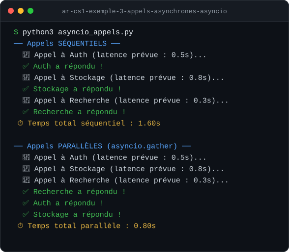

<div align="center">

# Distributed Applications Labs

Small Python programs on how distributed services talk to each other: HTTP client and server, retries with backoff, async calls, and safe serialization.


<sub>Course labs · Distributed Applications · EIDIA, Euro-Mediterranean University of Fes</sub>

[Labs](#labs) &nbsp;·&nbsp; [Example output](#example-output) &nbsp;·&nbsp; [Getting started](#getting-started)

</div>

## Overview

Each folder is a self-contained example built during the labs, using the Python standard library wherever possible. Together they cover the basics of distributed communication, client-side resilience, and the security risks of parsing untrusted data.

## Labs

| Session | Folder | What it shows |
|---|---|---|
| 5 · Distributed concepts | `ar-cs1-exemple-1-mini-client-serveur-http` | A minimal HTTP server and a client that calls it |
| | `ar-cs1-exemple-2-retry-backoff-exponentiel` | Retrying a failing call with exponential backoff |
| | `ar-cs1-exemple-3-appels-asynchrones-asyncio` | Sequential calls versus parallel calls with `asyncio.gather` |
| 6 · APIs and reliability | `ar-cs6-exemple-1-mini-api-http` | A small JSON HTTP API |
| | `ar-cs6-exemple-2-client-urllib-timeout-request-id` | A `urllib` client with timeouts and a request ID header |
| | `ar-cs6-exemple-3-retry-backoff-exponentiel` | Backoff applied to the API client |
| 7 · Serialization | `seance7-demo-1-json-robuste` | Strict JSON validation before deserializing |
| | `seance7-demo-2-xml-parsing-securite` | Parsing XML while rejecting `DOCTYPE` and entity declarations (XXE defense) |
| | `seance7-demo-3-protobuf-python` | Encoding, decoding and schema compatibility with Protocol Buffers |

## Example output



<sub>Real output of the asyncio lab (messages are in French): three calls take 1.6 s one after another and 0.8 s in parallel, the time of the slowest call.</sub>

## Getting started

**Requirements**: Python 3.10 or newer. Only the Protobuf lab needs extra packages: `protobuf`, and `protoc` if you regenerate `document_pb2.py`.

```bash
# Example: client and server in two terminals
cd ar-cs1-exemple-1-mini-client-serveur-http
python3 serveur.py
python3 client.py

# Example: async calls
python3 ar-cs1-exemple-3-appels-asynchrones-asyncio/asyncio_appels.py
```

## Author

Yassine Aitaouicha

---

<div align="center"><sub>Part of <a href="https://github.com/creepout777">Yassine Aitaouicha's projects</a></sub></div>
